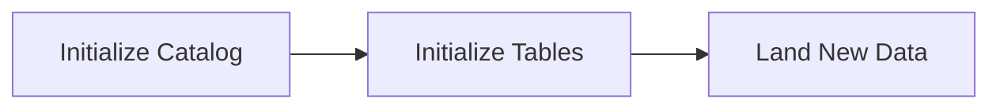
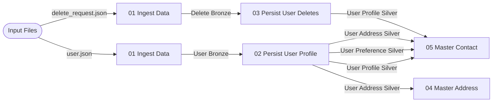

### Background
One of the more interesting projects that I worked on in my previous role was a contact mastering pipeline that would deduplicate contact data from other sources and master them alongside existing contacts in our system. After gaining the [Databricks Certified Data Engineer Professional Certification](https://www.databricks.com/learn/certification/data-engineer-professional), I wanted to implement something that allows me to apply some of topics that I learned. Additionally, I would gain experience using different processing capabilities such as Apache Spark, instead of the T-SQL stored procedure logic that I am used to.
### Implementation
The requirements themselves were loosely based the project that I implemented at my previous role. The previous requirement included fuzzy matching on First and Last Name, alongside an exact match with email and/or phone number. Incoming records would be mastered against our applications' main table then upserted against either the main table or an additional table. For this new process, I only maintained one user table and mastered against a single contact table. This narrowing of the requirements allowed me to focus on the contact mastering process while being able to rapidly explore multiple implementations. 

*Figure 1: Initialization Diagram*

*Figure 2: Data Process Diagram*

The data processing steps are as follows: 
1. ***Initialization***: Both `user.json` and `delete_requests.json` are generated at random and loaded into the schema's volume for processing. Reference tables are initialized at this step as well as any job level configurations. 
2. ***Ingest Data***: Data is ingested using Apache Spark's `readStream` functionality, as this offers a way of creating processes without having to implement custom checkpointing logic either within the table or with a control table. Both incoming files are processed and stored in bronze layer tables (`raw_user`, `raw_delete_request`)
3. ***Persist User Profile***: From the bronze user table, data would be parsed and split between `slv_user_profile`, `slv_user_preerence` and `slv_user_address`. The user data itself comes as a delta file, whereas the preference and address details are ingested as full loads. So those sub-objects are merged against existing records for the same username and deletions are handled on-the-fly. 
4. ***Persist User Delete***: User deletions are then processed after users are persisted. For the matching username, records are logically deleted from the `slv_user_profile` table. Additionally, user deletions are persisted in `slv_user_deletion_reason`, a 3NF table containing the user and a classification of the reason why they wanted their information removed. Classification was done through `ai_classify`, matching against labels from the `ref_deletion_reason`
5. ***Mastering***: Once user details were finalized in the silver layer tables, contact and address records would be mastered and a "primary" contact would be identified. For addresses and contacts the process is slightly different, but ultimate grant similar results. For both processes a full set of changes would need to be identified the updated delta as to increment the records from a previous set of relationships to a new set of relationships. Once records were grouped and a primary record was identified, the result would be merged into their respective `mst_contact` or `mst_address` tables. For the mastering itself, the methods varied for contacts and accounts: 
	1. **Addresses:** I kept the logic simple with concatenating all address details into a single string, rolling it up in to a single record and generating a UUID deterministically. 
	2. **Contacts**: The mastering required creating two data frames, `nodes_df` and `edges_df`. `Nodes_df` contains a list of uniquely identified records and their ideal `base` node, whereas `edges` contains a list of related records (either by email or phone) that would collectively represent a directed graph. The graph would then be topologically walked from one node to the next as long as the next node's is less than the currents', effectively resolving to a single base node. Once there were no new changes between the pervious and current iterations, the base would be found; a UUID was then generated from that value. 
#### Considerations
- Inbound files would be processed using JSON. This was done to simplify the ingestion process by ensuring that user details are rolled up onto the same record. I also wanted to experiment with Auto Loader and streaming tables and explore options for delta (`user` and `delete_request`) and full load (`user.address` and `user.preference`) datasets.
- The full pipeline was split between two processes: `data generation` and `data processing` for two reasons. First, data lineage between the two parts of the processes can be neatly identified. Second, the initial load process can be scheduled or run based off a trigger, whereas data generation would be more of a manual process. 
- The pipeline is packaged using Databricks Asset Bundles for portability. This could be automated and enhanced given that I was developing this for dedicated compute. 
- Topological graph traversal could be done procedurally or recursively. However, due to it being possible hit the max recursive depth, an procedural implementation was followed. 
### Brainstorming
For future revisions, I would likely apply the following additions: 
1. Records would be fuzzy matched based on the `First Name` field. This would probably need to be implemented creating a unique key based off of a reduction of the first name. Such as "Billy", "William" and "Bill" all resolving to the same UUID value.  I can also look to using Apache Lucene for full-text indexing. 
2. I wanted to leverage GraphFrames, a graph processing framework built on top of Apache Spark. A graph would be constructed based off what edges met the business criteria, connected nodes would be identified and a base would be assigned a persistent UUID. However, I was running into some difficulty with implementing it while leveraging Databricks' Free edition which made use of serverless compute.
3. I wanted to focus on pipeline development, however, I would like to leverage Apps in Databricks to allow "users" to explore these records in the same manner that a CRM application would. 
4. Use SDP for rapid development of data ingestion processes, but then implement the remaining part of the pipeline through a job implementation. Alternatively, I could implement the entire pipeline using SDP syntax. Additionally, the current implementation does not include any mechanism for schema evolution; ideally that would be enabled under SDPs. 